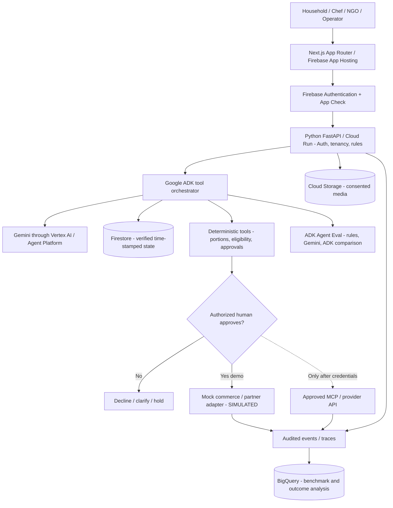

# EcoLoop AI — Master Product Specification

**Version:** 1.0 — 15 October 2026  
**Status:** Concept and pre-build design, not an implemented or impact-validated product.  
**Hackathon:** AI Builder Cup 2026 — Sustainability & Social Impact.  
**Stack:** Next.js/TypeScript on Firebase **App Hosting**, Python FastAPI + Google Agent Development Kit (ADK) + Gemini on Google Cloud Run/Vertex AI, Firestore, Cloud Storage, BigQuery.  
**Deployment target (unverified):** `project-7eb2c8c6-27da-46d0-827`  
**Production constraint:** Google models and Google Cloud-managed infrastructure; Next.js and other audited open-source packages are permitted. External merchants, NGOs and waste operators are third-party business endpoints requiring explicit authorization, not model providers.  
**Account access, quotas, partner permissions, deployments and benchmark results are NOT VERIFIED.**

## 1. Executive thesis and positioning

**One-liner:** EcoLoop is a proposed resource-decision copilot that connects household and organizational food decisions with safe recovery, appropriate organic processing, and *verified* outcomes.

**Problem:** The person purchasing food is often not the person preparing or consuming it. Late attendance changes, shopping across channels, partial fulfilments, overstated portions, and separated inventory systems can leave usable food wasted. Institutions may commit meals before accurate attendance is known. Potentially eligible unused surplus may require several time-sensitive human approvals before redistribution; genuinely unsuitable/inedible organics require authorized collection and processing. Information may be fragmented between decision owners, but **the software-addressable share after existing tools is not yet established**.

**Product hypothesis:** One low-friction, role-aware, evidence-backed workflow can help people respond to changes at the right time and prove what happened afterward. The product does not invent the grocery inventory, recipes, food donations, or composting; it combines *existing capabilities* across roles. We must show a meaningful improvement over current competitors and simple non-AI methods.

**Long-term vision:** After food is validated, use the same consent, provenance, tool orchestration and outcome architecture for energy, water, reuse/repair and sustainable procurement. Do **not** claim AI growth causes everyday food waste. Evaluate the computing footprint of the product itself.

## 2. Who is affected and why it matters

| Segment | Decision owner | Recurring decision to study | Consequence | Key restriction |
|---|---|---|---|---|
| Shared Indian metro household | Buyer, cook, adult diner | What to purchase/prepare when plans change | Edible kg discarded, avoidable INR spent, labor | Consent among household members; do not infer food safety |
| Single person/flatmates | Food owners/cooks | Pack size, shared vs private food and irregular meals | Spoilage and coordination friction | Do not surveil schedules or force shared purchases |
| School/college/office kitchen | Headcount coordinator, chef, manager | Adjust preparation before irreversible batch cutoffs | Excess prep, plate waste, food-service cost | Nutrition and food-service safety |
| Restaurant/grocer/dark store | Owner/inventory lead | Handle genuinely unused, eligible surplus | Shrink and potential recoverable edible food | Business permissions; safe handling records |
| Food-recovery NGO | Qualified coordinator, volunteer | Accept or reject eligible offers with verified capacity | Eligible food lost to delay; staff effort | FSSAI regulations, cold chain, transportation |
| Receiving institution | Qualified community kitchen/care facility | Will suitable food be accepted and consumed? | Resource access if real match, no automatic hunger claim | Diet, consent, receipt/traceability |
| Apartment RWA/processor | RWA, collector, authorized processor | Which organic loads were actually accepted and processed? | Contamination, operating cost, environmental reporting | Local SWM rules, lawful transport and processing |

## 3. Evidence and impact (FACTS vs HYPOTHESES)

**Official macro evidence:** UNEP Food Waste Index 2024 estimates 1.05 billion tonnes food wasted at household, retail and foodservice levels in 2022, including inedible material; households account for approximately 631 million tonnes. FAO estimates 13.3% postharvest-to-pre-retail loss globally in 2023 using a different denominator. Do not add these values or call them app-addressable TAM. Global food loss/waste has been linked to about 8–10% of GHG emissions; this is **not** the emission savings of our product.

**India household observation:** Delhi, published 2026, 56 households physically assessed for seven days; mean avoidable food waste 0.749 kg/household/week. Poor planning, coordination and changed routines appeared in the study. This is a small, seasonal/geographic sample, **not** the India household mean or a causal app trial.

**Kitchen observations:** Beijing 2024: 656 workplace canteen diner observations, reported around 78.8 g edible lunch plate waste per diner; not unserved preparation waste. An Australian 355-bed hospital 2026 study recorded 170.4 g kitchen waste per meal produced (including 149.3 g unserved); not all safely recoverable. German 2024 studies reported considerable improvements with non-AI smaller portions and other measures; do not attribute all reducible waste to Gemini.

**India circular organics:** An original 2026 study covered 517 operational decentralized composting sites, 2,373 units and ~2,085 tonnes segregated organics (FY2024–25) in four Indian metro areas; this establishes scale and operational/accounting complexity but not a gap caused by missing AI.

**Industry trends:** India FY2024 Redseer reported about 6 quick-commerce orders per monthly transacting user, metro-heavy. This **does not prove** shopping frequency increases edible food waste; rapid top-ups may reduce bulk overbuying.

**Illustrative impact math ONLY:** 1,000 hypothetical households × 0.749 kg/week from the sampled Delhi baseline × 52 weeks × assumed 10% sustained reduction = 3,894.8 kg/year (~3.9 tonnes). This is not a forecast, trial result, TAM, verified emission/water saving or guaranteed growth. Report the assumption visibly and vary baseline, adoption, duration and actual reduction in sensitivity analysis. NGO metrics are eligible offers successfully delivered/accepted, not meals claimed. Organics metrics are processed kg, not merely picked up kg.

**Unknowns:** repeated failure frequency after competitors; users reachable through metro channels; authentic item and waste logs; effort saved; willingness to pay; developer rights for partner MCP; NGO capacity; true trial effect; per-food impact factors; app compute resource use. Do not invent numbers.

## 4. Why competitors have not necessarily solved the exact gap

| Category | Named alternatives / status quo | What they already do | Residual gap to test (NOT a verified deficiency) |
|---|---|---|---|
| Home inventory/planning | NoWaste, Samsung Food, Panasonic KitchenPocket, shared Google Calendar/WhatsApp, paper notes | Photo/receipt entry, shared inventories, expiry/use-first and recipes | Can household/meal changes propagate to the actual cook and purchase decision with less effort than these approaches? |
| Quick commerce | Swiggy Food/Instamart MCP, Blinkit, Zepto, BigBasket, kirana | Catalogues, carts, buying, delivery and some collaborative ordering | Can the planned cart be better reconciled with verified existing stock and changed meal participation? |
| Kitchens | Winnow, Leanpath, Orbisk, SmartQ, attendance sheets, signage, portion policies | Measured kitchen waste, analysis, forecasting and low-tech fixes | Are small-site late changes from messy notes genuinely missed by clean headcount/forecast workflows? |
| NGO recovery | FSSAI IFSA, Robin Hood Army, Feeding India, Goodr, RescueLens, phones/WhatsApp | Donation networks, matching, reporting, NLP incident flags | Do eligible offers fail due to correctable information mismatches once logistics and food safety are satisfied? |
| Organics | Saahas, Hasiru Dala, municipal providers, signed weights/Sheets | Segregation, collection, composting, traceability | Are actual processing and reject/acceptance records materially incomplete beyond existing systems? |

**We do not know competitor motives.** Specialization, data silos, cost, API scope and physical logistics are hypotheses rather than statements that rivals neglected customers. The strongest rival may be a familiar, inexpensive list and habit change.

**Direct winner precedent:** Savour placed first runner-up in the 2024 AI for Impact APAC competition using food inventory/recipe/expiry planning. Padayon Ko won by simplifying scholarship discovery and application. Google Cloud 2025 Gen AI Exchange winners included compliance test automation, TripAI booking/itinerary integration, GovernAI service routing and Legal SahAI document/RAG/forms. These show familiar components can form winning submissions; they do **not** prove our implementation will win or that judge scores favored any particular technology.

## 5. Opportunity breakdown: from needs to candidate solutions

### O1 — Household change-of-plans decisions
- **User job:** Confirm existing food, account for people actually eating, adjust portions and avoid unnecessarily buying ingredients.
- **Trigger:** Dinner for four becomes dinner for two after groceries arrive.
- **Existing process:** Messages → fridge guess → fixed recipe → optional quick-commerce top-up → some food discarded.
- **Proposed:** Upload/confirm receipt/stock → member reports plan change by text/voice → Gemini normalizes → verified Firestore state reconciles → deterministic portions and restrictions → cook reviews 1–2 options → optional **mock** shopping cart → record outcome.
- **AI fit:** Messy multimodal intake and event interpretation, with controlled tool orchestration; quantities/authorization remain Python code.
- **Fail if:** A shared list or ordinary Gemini does as well with less effort; accurate stock takes constant data entry.

### O2 — Institutional cooking cutoff
- **User job:** Decide quantities before preparation becomes irreversible, without sacrificing appropriate nutrition.
- **Trigger:** Attendance drops / menu substitution arrives late.
- **Proposed:** Captured headcount + menu + unstructured notes → Gemini extracts change → rules and optional historical BigQuery forecasts → chef approves actual batch change → separately weigh prep, unserved and plate food.
- **AI fit:** Understanding exception notes, not pretending a language model predicts exact future meal counts.
- **Fail if:** QR attendance/basic deterministic forecast already solves it; input arrives too late or meals are rejected for taste instead.

### O3 — Eligible surplus and NGO coordination
- **User job:** Move **qualified, safe, unused and unserved** food to a **verified, consenting** partner before the authorized time window closes.
- **Trigger:** Restaurant/institution reports potential surplus.
- **Proposed:** Gemini structures donor batch information → mandatory proof completeness check → **human** food-safety/eligibility review → partner verifies capacity → recipient accepts → driver records pickup/custody → delivered/accepted quantity logged.
- **AI fit:** Variable donor text, explanations and routing questions; not a microbiological detector or legally qualified agent.
- **Fail if:** Vehicles, budgets, cold chain, eligibility or receiving demand dominate; a Google Form plus rules works equally well.

### O4 — Genuine wet waste / apartment circularity (conditional)
- **User job:** Segregate suitable wet residuals and prove that an authorized operator actually processes them.
- **Trigger:** Truly inedible peels or unsuitable organic material remains after consumption/recovery, not 'surplus for orphans'.
- **Proposed:** Resident follows municipal accepted-material rules → collection worker weighs + signs → operator accepts/rejects → processor logs treatment/output → RWA dashboard shows reconciliation, rejects and actual processed amounts.
- **AI fit:** Multilingual report extraction and resolving inconsistent receipts; conventional rules and physical systems likely dominate.
- **Fail if:** Signs, contractor service and spreadsheets suffice or no operator will share genuine records.

## 6. Current versus future user journeys

| Role | Current journey (hypothesis) | EcoLoop proposed journey | Verifiable outcome |
|---|---|---|---|
| Household buyer/cook | Buy independently, ask others, guess pantry, cook when dinner plan changes | Consent-based capture → confirm stock → recognize changed attendance → choose smaller/use-first plan → approve mock cart | Edible grams physically discarded / household-week; task minutes |
| Institutional chef | Headcounts in spreadsheet/chat → prepare batch → late absence → record waste separately | Approved roster event → Gemini parses → rules compare cooking cutoff → chef approves new quantity → weigh separate categories | g prep vs plate vs unserved per actual meal |
| Food donor/recovery NGO/recipient | Donor messages/photos → eligibility phone checks → capacity calls → handoffs and partial records | Versioned batch → missing-proof prompts → qualified review → NGO/recipient confirm → chain of custody → record accepted kg | Eligible accepted offers / eligible offers; actual accepted kg |
| Apartment resident/collector/operator | Separate scraps → collection → reported diverted mass, limited trace | Accepted material guidance → signed weight → reject/processing evidence → RWA report | Collected vs accepted vs processed kg, contamination |

No part of this implies that plate leftovers or spoiled food can be handed to vulnerable care recipients. They are not default donation candidates.

## 7. Product capabilities and priority

**P0 — coding agent must implement:**
1. Hosted Next.js App Router responsive web app with demo-safe routes and good accessibility, optional PWA only later.
2. Firebase Auth (or conspicuously synthetic demo tenant) with distinct roles, tenant isolation and consent.
3. Three small scenario journeys, all with the same reusable intake/review/proposal/action/evidence components, but separate safety/eligibility.
4. Python FastAPI on Cloud Run; server-side Firebase ID token validation; versioned Firestore canonical facts.
5. Gemini via Google Vertex/Agent Platform to extract structured candidate information from text and optionally receipt/photo, with human correction.
6. One Google ADK orchestrator calling allowlisted Python tools. Tool calls never authorize themselves.
7. Deterministic calculation/eligibility checks, typed action drafts and approvals; external partners **SIMULATED** and visibly marked.
8. Case-level audit and outcome journal distinguishing measured vs mock.
9. Baselines: rules + Google Forms/Sheets, plain Gemini, incumbent capability comparison; 12–20 annotated gold cases per lane.
10. A working Firebase App Hosting HTTPS URL, Cloud Run backend, tests and honest 3-minute demo.

**P1 — gated:** Swiggy MCP real use after authenticated builder program/developer permission, permitted API scope and checkout terms; verified NGO records; actual warehouse/partner offerings; BigQuery forecasting with legitimate historical kitchen data; PWA manifest and safe shell caching; RAG for policy corpus if fixed official rule tables insufficient; partner-facing operator views and opt-in incentives.

**P2 — post-hackathon:** Organic processing with real operators, water/cooling/reuse/repair modules and resource-impact factor methodology; independent primary research and commercialization.

## 8. Technical architecture and trade-offs

**ADR-001:** Next.js + TypeScript + Firebase **App Hosting** instead of React/Vite + classic Firebase Hosting or a native Flutter app. Reason: app web-first, App Router and component ecosystem, server rendering if needed, managed Cloud Run/CDN/CI. Firebase's old framework-aware Hosting experiment is closed to new Next.js developers; static export with classic Hosting is possible if SSR not needed but is not default.

**ADR-002:** FastAPI Python + ADK in Cloud Run. Google supports Python FastAPI and a custom FastAPI/ADK integration. Reason: typed validation and Python ADK in one cohesive backend. Avoid exposing ADK debug UI publicly. Use persistent sessions, not the sample's local SQLite file in ephemeral Cloud Run. Pin supported SDK versions after checking actual environment.

**ADR-003:** Firestore transaction/versioned evidence for actual inventory and partner state; optional Memory Bank only for explicit opted-in preferences. Reason: memory is not reliably current food stock and cannot enforce transactions.

**ADR-004:** Gemini for ambiguous multimodal input, contextual explanation and approved tool choice; deterministic Python for arithmetic, deadlines, quantities, eligibility and permission. Reason: model hallucinations and security boundaries.

**ADR-005:** One orchestrator first rather than many agents. Reason: less complexity, cost, latency and easier trajectory evaluations. Split only with evidence.

**ADR-006:** Mock partner integration until rights confirmed; the existence of an MCP server is not developer access or an approved charge. Human must approve actual purchases and pickups.

**ADR-007:** Physically measured impact rather than automatically claiming '2 kg saved'. The model cannot infer avoided water/CO2 from a successful tool call.

**ADR-008:** Ray/Earth Engine/continuous multimodal video/long-term memory/agent self-improvement deferred until genuine need. These don't automatically earn hackathon points and may increase overhead.

**App hosting gotcha:** Firebase App Hosting supports Next.js and can connect GitHub for rollouts; requires project setup and billing. Standard Firebase Hosting's framework-aware Next.js experiment is not the recommended path for new accounts. Choose a supported Next.js/Node version from current Firebase compatibility table (don't assume any future preview model/runtime exists in our specific project).

## 9. Data contracts and role/permission safeguards

Entity models (typed schemas):
- `Tenant`: id, type, region, policy version.
- `Membership`: actor, tenant, permission scopes, consent and revocation.
- `Evidence`: original receipt/notes, source, time, actor, retention status.
- `InventoryObservation`: name, normalized unit/quantity, candidate/confirmed/disputed/stale, provenance and last verification.
- `MealPlan`: scheduled date, confirmed diners, change events, decision cutoff.
- `KitchenBatch`: planned vs actual diners, menu/cutoff, separate stage-specific mass (edible/inedible).
- `FoodOffer`: unused/unserved status, evidence, human eligibility review, donor/NGO/recipient approval, custody events.
- `OrganicLoad`: collected, accepted, rejected, processed, outputs, evidence and authorized operator.
- `ActionProposal`: tenant, author, immutable preview, approval actor, expiry and status; mock flag.
- `OutcomeRecord`: measured/simulated/unknown, unit, weight, method and evidence reference.
- `AgentTrace`: model ID, redacted tool sequence, errors, latency, tokens and cost.

**Hard invariants:** a photo never certifies food safety; a model candidate never becomes verified fact without user review; no cross-tenant read; no checkout/donation without real user/partner authorization; no actual impact until observed; no private household schedule used for hidden monitoring; no messages to real NGO or contact with vulnerable recipients in demo.

## 10. Functional endpoints (proposal)

- `GET /health` — version and availability, no secrets.
- `GET /v1/demo/scenarios` — synthetic-only fixtures.
- `POST /v1/intake/parse` — candidate extraction; does **not** commit.
- `POST /v1/facts/confirm` — verified versioned input after role validation.
- `POST /v1/meal-plans/change` — authorized attendee event.
- `POST /v1/decisions/evaluate` — one or two traceable proposals + rule checks/uncertainties.
- `POST /v1/actions/preview` — immutable explicit proposed action, `simulated: true` P0.
- `POST /v1/actions/{id}/approve` — verify approver, expiry, idempotency, scope; mock execution P0.
- `POST /v1/kitchens/batches` — actual/synthetic kitchen counts and stage measurements.
- `POST /v1/recovery/offers` and `/accept` — separate donor, NGO and recipient approval.
- `POST /v1/outcomes/measured` — physical measurement with method/evidence or clear unknown.
- `GET /v1/evaluation/results` — only run-specific actual results.
- `DELETE /v1/users/me/context` — scoped deletion subject to retention requirements.

## 11. Proposed three-prototype comparison

For each household, kitchen and recovery candidate, prepare 12–20 annotated gold examples including adversarial/unsafe cases. Give **equivalent inputs and privileges** to (a) Google Form/Sheet + fixed rules, (b) ordinary Gemini, (c) available incumbent flow or documented substitute, (d) EcoLoop ADK + verified state. Measure correctness, effort/minutes, step count, task completion, unsafe suggestions, tool trajectory, latency/tokens/cost, and offline fallback/denied actions. Do not report numbers until the tests are run. Real-world waste savings need separate permissioned weighed baseline and credible comparison.

**Suggested gold cases:**
- H1: diners cancel before cooking; H2: mistaken receipt quantity; H3: two separate shoppers buy duplicate milk but one already consumed; H4: stale fridge photo; H5: changed meal after cook cutoff; H6: OCR unit confusion 500g/500ml; H7: injected receipt text attempts checkout; H8: one adult revokes sharing.
- K1: class/group absent before cooking; K2: too late after batch prepared; K3: substitution violates recorded dietary requirement; K4: plate waste vs unserved counted separately; K5: headcount-only beats AI on simple case; K6: food-server role cannot alter approved menu.
- R1: unused packaged eligible candidate; R2: already served food MUST NOT transfer; R3: temperature record incomplete -> human review; R4: recipient has dietary mismatch; R5: NGO van not available; R6: revoked/cancelled offer; R7: fake partner registration badge cannot prove food safety; R8: custody log missing receipt; R9: expired offer should never dispatch.

## 12. Measurement, ethics, acceptance and performance

Use primary objective: reproducible correct *decision* and lower real user effort before selecting a product. Outcome metrics stay stage-specific: household avoidable edible grams/household-week; kitchens grams per actual served meal by stage; recovery verified safe accepted kg and eligible accepted share; wet processing actual accepted/processed/reject outputs. Money requires real weighted cost evidence. Climate/water conversion requires food-specific context, disposal and counterfactual plus compute/transport resource burdens.

Acceptance: web frontend loads via publicly shareable HTTPS URL, works at mobile 360px, no native-store dependency; Gemini response from real configured Google project; mocked actions prominently simulated; sample actor attempts unauthorized action and backend rejects; runtime and model versions logged; trace of tool execution; no hallucinated food safety; three journeys reproduce using fixture IDs; test matrix output and failure cases available. Latency targets TBD from measurement; don't claim current SLA.

## 13. Should we solve this now? Decision gates

**Yes to a narrow technical/UX comparative prototype now.** The broad severity and direct Google technical feasibility are credible. **No to committing to a nationwide deployed recovery service or claiming environmental savings now.** All opportunities still need the strongest hard gates: (G0) relevant harm; (G1) specific residual failure after current alternatives; (G2) data rights/actor access; (G3) AI improves over rules/plain Gemini; (G4) safety/permissions; (G5) physically verifiable outcome; (G6) functional Google deployment. Any fatal failure overrides scores.

Problem Value Score /100 weights: urgency 15, frequency 10, population 10, workarounds/WTP 10, evidence 15, unmet need 15, why now 5, access 5, measurability 5, track 10. **Numeric score withheld** until G1/G2/G3 data; separate judging rubric 40 technical, 25 impact, 25 innovation, 10 UX. Official judges won't award points merely for using Ray or multiple agents.

## 14. What next (implementation backlog)

1. Verify exact official deadline, participation rules and user's GCP IAM/model/region/billing with consent; create budget alert.
2. Initialize monorepo and typed contracts, mock data, browser routes, App Hosting connection.
3. Build deterministic baseline and gold-case assertions before sophisticated prompting.
4. Build FastAPI+Firestore trusted records, Firebase Auth role verification, audit and unit tests.
5. Gemini structured extraction with explicit corrections, single ADK tool coordinator, regression tests.
6. One complete household plan-change golden flow with proposed cart but no real charge.
7. Add minimal kitchen batch exception and NGO offer eligibility **separately**; operator organics later.
8. Run fair head-to-head tests and capture actual results, red-team prompt injection, permissions and food-safety claims.
9. Deploy to Google Cloud, verify mobile browsers, collect trace/screenshots, record short 3-minute pitch.
10. Choose strongest actual workflow via Problem Value and official rubric, then seek authorized pilot/partner data; expand to resource modules only if demonstrated.

## 15. Documentation & first-party source links

**Google Drive canonical docs:**
- [Master product specification](https://docs.google.com/document/d/1vUPWozAbRPcEhdLW0Bd9gAhhLKYXsY8Kn3s0t8wiKHA/edit)
- [Winner analysis / competitor gaps](https://docs.google.com/document/d/1EdD0dt38IYM52DPtjzbreCunNlp7CW8od9Cd8tPmsfM/edit)
- [Coding agent handoff](https://docs.google.com/document/d/1i0TU3ILttOPLd4rEjCEUJL7HBK0cADV2QBuC_jUAD68/edit)
- [Previous research synthesis](https://docs.google.com/document/d/19yS-OQsZN7clk84vDIv0jhoRWvH7dcTV_cqjTvuQM_g/edit)
- [Evidence register](https://docs.google.com/spreadsheets/d/1yibPtJ92Rv0t-vhGIpFrE8kBa2WpxA17yN1P0Ku64vs/edit)
- [Architecture diagram](https://whimsical.com/3JX2Pwej8GHWVrMcDjQhuo)

**Product/research:**
- [UNEP Food Waste Index (2024)](https://wedocs.unep.org/handle/20.500.11822/45230)
- [FAO SDG global food losses](https://www.fao.org/sustainable-development-goals-data-portal/data/indicators/1231-global-food-losses)
- [Delhi measured food waste (2026)](https://www.sciencedirect.com/science/article/pii/S0950329325003064)
- [Yokohama municipal AI fridge/food monitoring (2026)](https://www.city.yokohama.lg.jp/kurashi/sumai-kurashi/gomi-recycle/sakugen/shoku-loss/2025syokulosstyosa.html)
- [Hospital kitchen waste (2026)](https://doi.org/10.1016/j.wasman.2025.115242)
- [Beijing workplace food waste (2024)](https://doi.org/10.3389/fsufs.2024.1455756)
- [India decentralized composting observational research (2026)](https://doi.org/10.1016/j.wasman.2026.115633)
- [FSSAI Surplus Food Regulations (2019)](https://www.fssai.gov.in/upload/uploadfiles/files/Gazette_Notification_Surplus_Food_06_08_2019.pdf)
- [Swiggy announced MCP (2026)](https://www.swiggy.com/corporate/press-release/swiggy-now-lets-you-order-food-dineout-and-shop-on-instamart-directly-inside-chatgpt-and-claude/)
- [AI Builder Cup judging rubric](https://aibuildercup.com/themes.html)

**Winner precedents:**
- [AI for Impact 2024 Savour and Padayon Ko](https://blog.hack2skill.com/teams-that-emerged-victorious-ai-for-impact-hackathon)
- [Google Cloud GenAI Exchange professional and student winners (2025)](https://yourstory.com/2025/12/google-cloud-gen-ai-exchange-hackathon-the-10-innovations-that-stood-out-this-year)
- [Google Gemini Live 2026 winners](https://cloud.google.com/blog/topics/developers-practitioners/winners-and-highlights-of-the-gemini-live-agent-challenge)

**Google technical:**
- [Firebase App Hosting for Next.js](https://firebase.google.com/docs/app-hosting)
- [Next.js old Firebase Hosting experimental path warning](https://firebase.google.com/docs/hosting/frameworks/nextjs)
- [Cloud Run FastAPI quickstart](https://docs.cloud.google.com/run/docs/quickstarts/build-and-deploy/deploy-python-fastapi-service)
- [ADK custom FastAPI/Cloud Run](https://adk.dev/deploy/cloud-run/)
- [ADK source docs](https://adk.dev/)

**Research/prototype status at authoring:** No live pilot, no code, no demonstrated AI uplift, no verified partner API access, no baseline scores. This document is a directive to *test* the proposed workflow, not to claim product success.

## 16. Verified AI Builder Cup submission deadline and mandatory deliverables

As of **15 October 2026**, the [official AI Builder Cup homepage](https://aibuildercup.com/) lists **18 October 2026** as the prototype submission deadline. The [themes and submission page](https://aibuildercup.com/themes.html) requires a **functioning Google AI prototype deployed on Google Cloud via Cloud Run/Firebase**, a **proposal deck/PPT converted to PDF**, a **three-minute public video or public Google Drive demo link**, English-language materials, and clear track/theme identification. Documents and mockups alone are insufficient. The organizer may update requirements; reconfirm immediately before final submission.

**Prioritize a functional one-lane golden path first**; add the kitchen and NGO flows as small verified or explicitly simulated extensions only after the deployed core works. The presentation was previously paused by the user; preparing the final submission deck should resume only on their request, but it is a mandatory submission artifact.

### Editable diagrams

- [Next.js → FastAPI → Google ADK system architecture](https://whimsical.com/3JX2Pwej8GHWVrMcDjQhuo)
- [Before vs after household, kitchen, NGO, and organic waste workflows](https://whimsical.com/KZnMgM3wuEq12U5aoQ9Zcu)
