# EcoLoop — Editable Mermaid Diagrams

These reproduce all 14 diagrams embedded in the consolidated blueprint. They are design diagrams, not actual deployed architecture.

## 01 Core Product Loop

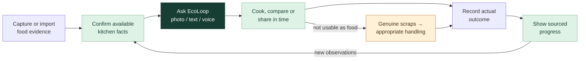

## 02 Screen Navigation

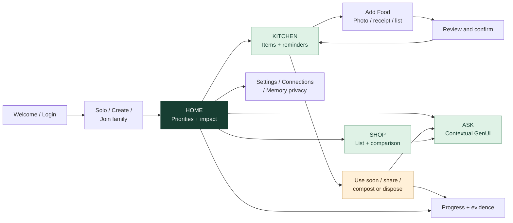

## 03 Onboarding And Consent

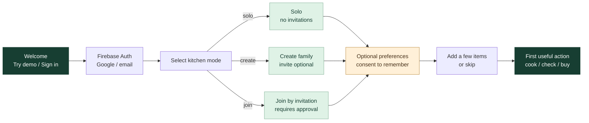

## 04 Multimodal Capture And Commit

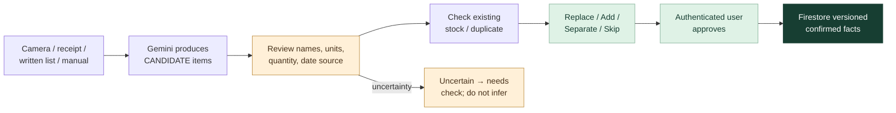

## 05 One Assistant Many Contexts

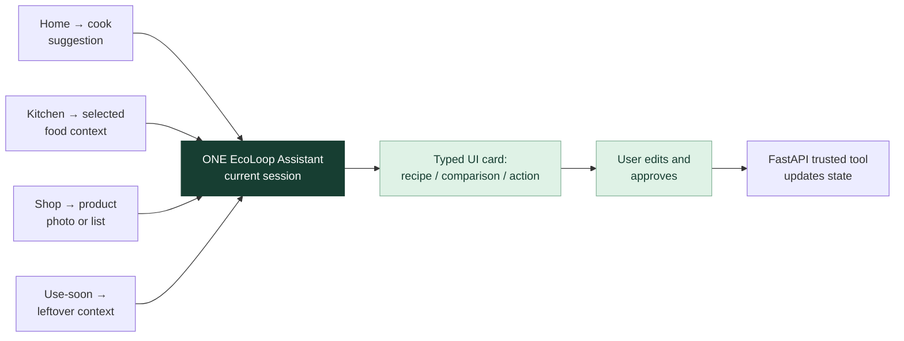

## 06 Shopping Decision

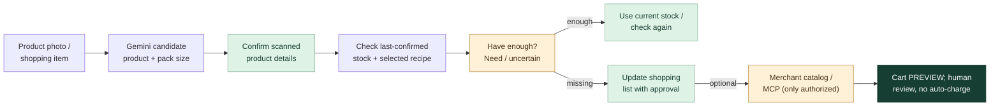

## 07 Prevention Sharing And Disposal

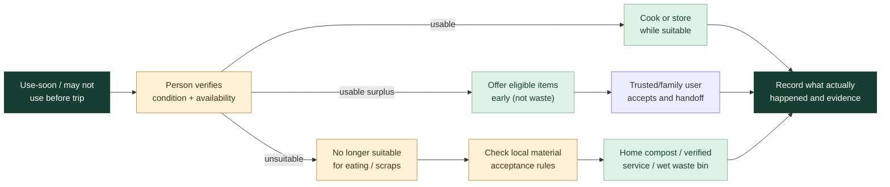

## 08 Impact Evidence Ladder

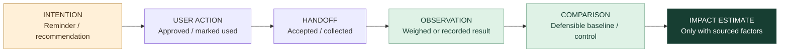

## 09 Google Cloud Runtime Architecture

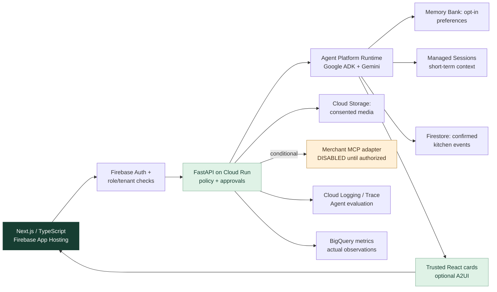

## 10 Adk Delegation And Tools

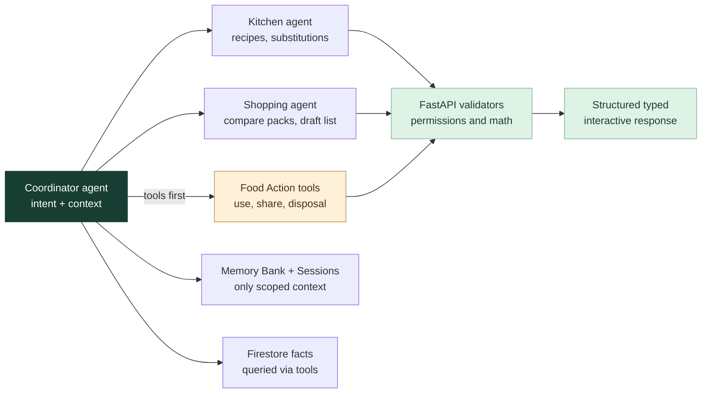

## 11 Status State Machines

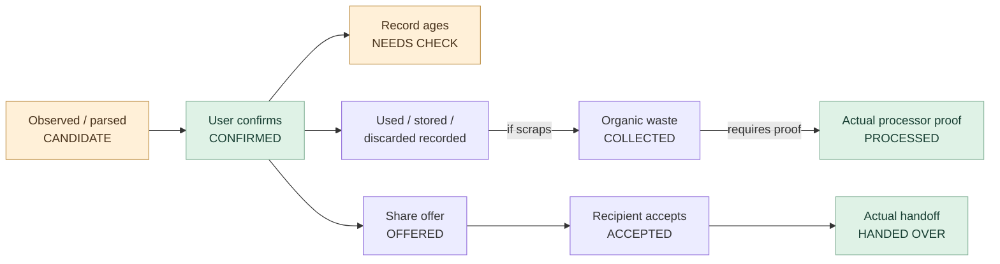

## 12 Three Minute Demo Timeline

```mermaid
flowchart LR
  PROB["00:00–00:20<br/>Problem + Home"]
  CAP["00:20–00:48<br/>Capture + correction"]
  CHAT["00:48–01:28<br/>Memory + interactive cards"]
  SHOP["01:28–02:05<br/>Photo: Should I buy?"]
  SHARE["02:05–02:37<br/>Offer early / record"]
  PROOF["02:37–03:00<br/>Google tools + eval proof"]
  PROB --> CAP
  CAP --> CHAT
  CHAT --> SHOP
  SHOP --> SHARE
  SHARE --> PROOF
  classDef core fill:#173e32,color:#fff,stroke:#173e32
  classDef action fill:#dff2e6,color:#173e32,stroke:#85b299
  classDef caution fill:#fff0d8,color:#47311a,stroke:#bd8e43
  class CAP action
  class SHOP action
  class PROOF core
```

## 13 Permissions And Ownership

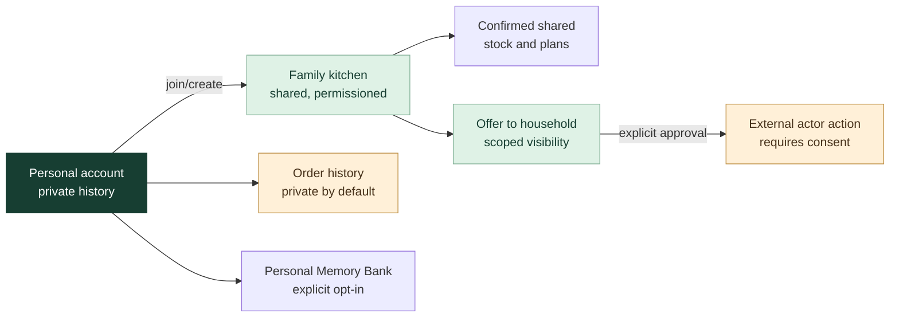

## 14 Coding Gate Sequence

```mermaid
flowchart LR
  A["G0 Design tokens<br/>+ routes"]
  B["G1 Mock data<br/>+ deterministic flows"]
  C["G2 Auth + Firestore<br/>role protections"]
  D["G3 Gemini photo<br/>+ user confirmation"]
  E["G4 ADK + Memory Bank<br/>+ typed GenUI"]
  F["G5 Sharing/outcome<br/>+ optional MCP mock"]
  G["G6 Real tests<br/>+ Google deployment"]
  A --> B
  B --> C
  C --> D
  D --> E
  E --> F
  F --> G
  classDef core fill:#173e32,color:#fff,stroke:#173e32
  classDef action fill:#dff2e6,color:#173e32,stroke:#85b299
  classDef caution fill:#fff0d8,color:#47311a,stroke:#bd8e43
  class B action
  class C action
  class F action
  class G core
```
