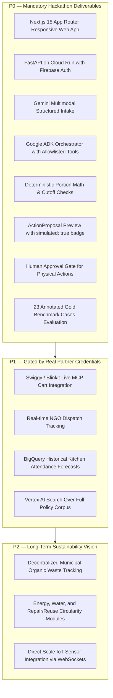

# EcoLoop AI — Product Capabilities Matrix

> Canonical reference mapping business opportunities (O1–O4) to technical components, data contracts, AI fit boundaries, and verification criteria.

---

## 1. Opportunity to Technical Capabilities Mapping

| Opportunity | User Job & Problem | AI Fit (Gemini / ADK) | Deterministic Python Boundary | Canonical Firestore Contracts | Verified Outcome Metric |
|---|---|---|---|---|---|
| **O1: Household Plans Change** | Diner cancels or attendance changes after groceries arrive. Cook needs to know what to prepare and avoid duplicate shopping. | Parses messy messages, receipt images, or audio transcripts into structured change events (`PlanChangeEvent`). | Portion math, ingredient scaling, stock reconciliation against active pantry, mock cart generation. | `tenants/{id}/evidence` `tenants/{id}/inventory` `tenants/{id}/meal_plans` `tenants/{id}/decisions` | Avoidable grams discarded per household-week; INR saved on avoided top-up items. |
| **O2: Kitchen Cooking Cutoff** | Institutional kitchen (school/office) receives late attendance drop. Chef must adjust preparation before irreversible batch cooking. | Extracts attendance numbers and exception notes from unstructured emails/roster sheets. | Time differential calculation ($\Delta t = t_{meal} - t_{now}$), comparison with cutoff threshold ($45\text{ min}$), recipe ingredient scaling. | `tenants/{id}/kitchen_batches` `tenants/{id}/cutoffs` `tenants/{id}/waste_logs` | Unserved preparation mass ($M_{unserved}$) prevented; separate stage mass ($M_{prep}$, $M_{plate}$). |
| **O3: Qualified Surplus & NGO Recovery** | Restaurant or caterer has unserved, edible surplus food requiring safe, legal transfer to verified NGOs before expiry. | Structures donor batch details; queries Vertex AI Search for FSSAI compliance clauses. | FSSAI temperature checks ($\ge 65^\circ\text{C}$ hot, $\le 5^\circ\text{C}$ chilled), 4-hour window validation, role-permission verification. | `tenants/{id}/food_offers` `tenants/{id}/custody_logs` `tenants/{id}/inspections` | Verified accepted kg delivered to authorized recipient; zero food safety violations. |
| **O4: Genuine Organics & Composting** | Inedible scraps (peels, plate waste) must be segregated, collected, and proved to have been processed by authorized composting. | Multilingual waste receipt extraction; operator report anomaly detection. | Scale weight reconciliation, moisture and contamination tolerance verification, diversion rate calculation. | `tenants/{id}/organic_loads` `tenants/{id}/processors` `tenants/{id}/compost_batches` | Kilograms diverted from landfill to verified composting; contamination percentage. |

---

## 2. Capability Implementation Tiers

---

## 3. Strict Boundary Rules

1. **Food Safety Isolation**: No model output can ever bypass human inspection or declare food safe.
2. **Simulation Transparency**: Any external commercial integration without an active enterprise API key must prominently show `[SIMULATED DEMO ACTION]`.
3. **Data Consent**: Household members retain the right to revoke inventory sharing or soft-delete personal meal history at any time (`DELETE /v1/users/me/context`).
