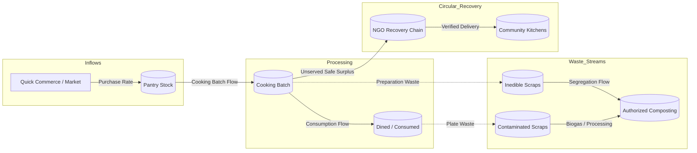

# Systems Thinking Architecture for EcoLoop

> Applying system dynamics, stock-and-flow modeling, and feedback loop analysis to circular resource management.

---

## 1. System Dynamics Diagram: Stocks and Flows

In traditional food consumption, materials move linearly:
$$\text{Purchase} \longrightarrow \text{Stock} \longrightarrow \text{Cooking} \longrightarrow \text{Landfill Waste}$$

EcoLoop introduces closed-loop regulatory valves and diversion pathways:

---

## 2. Core Feedback Loops

### Balancing Loop 1 (B1): Pantry-Aware Demand Throttling
- **Goal**: Prevent avoidable household overbuying.
- **Dynamic**: As pantry stock increases, EcoLoop identifies duplicate ingredients during meal planning. The proposed shopping cart is reduced by the quantity already present in stock, dampening purchasing rate.

### Balancing Loop 2 (B2): Kitchen Cooking Cutoff Intervention
- **Goal**: Prevent irreversible batch commitment.
- **Dynamic**: When attendance changes are captured prior to the 45-minute preparation deadline, the recipe scaling factor decreases. Less raw mass enters the cooking pot, preventing unserved surplus at the source.

### Reinforcing Loop 1 (R1): Verified Chain-of-Custody Trust
- **Goal**: Increase donor participation.
- **Dynamic**: High-transparency digital receipts and temperature logs reduce NGO liability concerns. Donors receive verified proof of acceptance rather than ambiguous donation claims, encouraging ongoing participation.

---

## 3. Information Delays as the Primary System Vulnerability

In system dynamics, oscillations and waste occur when information delays exceed physical response times:
1. **The Attendance Delay**: If a diner decides at 3 PM they cannot attend dinner, but notifies the household cook at 7:30 PM (after the rice and curry are cooked), the delay turns avoidable food into committed surplus.
2. **EcoLoop's Architectural Response**: Low-friction multimodal intake (quick voice notes, WhatsApp-like web hooks) directly compresses the information latency ($\Delta t \to 0$), enabling pre-cooking intervention.
