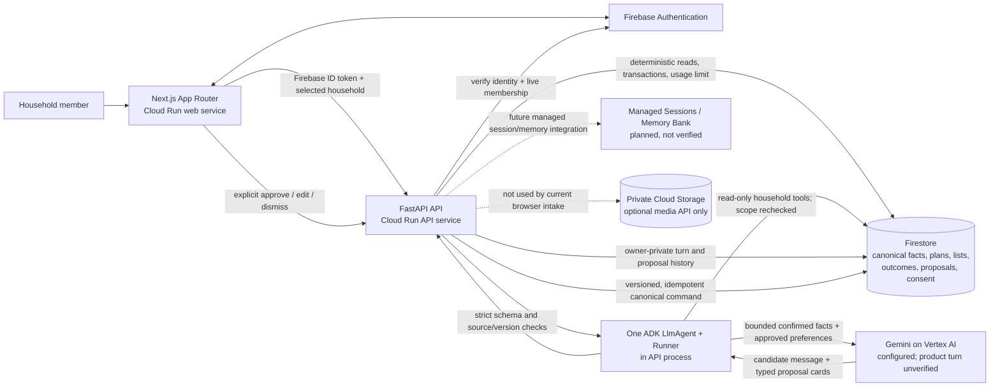

# EcoLoop product architecture — HLD and LLD

Updated 17 October 2026 against the current source and deployed Cloud Run project. The web and API services are deployed; signed-in household discovery and creation are accepted in Cloud Run. Vertex AI is configured and enabled on the API service, and a direct low-token Vertex model request succeeded. Two authenticated product ADK turns against Cloud Run timed out (at 20s and 50s); therefore end-to-end product AI is not yet accepted. Managed ADK Sessions, Memory Bank, Agent Runtime, and browser-to-private-media flow remain unavailable or unverified. Update those evidence labels when the environment changes.

## HLD — system shape



### Responsibility boundaries

- **Next.js:** sign-in state, selected-household UX, bounded transport, loading/error/conflict states, and five fixed typed card renderers. It never treats a model response as markup or an approved action.
- **FastAPI:** Firebase identity and household membership checks, bounded context loading, request limits, schema/source validation, proposal history, and canonical command transactions.
- **ADK/Gemini:** generates useful language and candidate suggestions from the current request and bounded household facts. Read tools are narrow and recheck household scope. The model cannot write records, determine exact quantities, certify food safety, or approve actions.
- **Firestore:** source of truth for confirmed food observations, shopping intent, saved plans, user-approved preferences, assistant proposals, and owner-recorded outcomes.
- **Cloud Run:** public web/API invocation for the browser; API routes still require Firebase identity and explicit active membership. API runtime uses its dedicated service identity.
- **Not part of the current live path:** managed Agent Runtime, managed Sessions, Memory Bank, real recipient/merchant operations, and private media intake. The app has one product agent. Coding assistants are development tools, not runtime agents.

## LLD — Ask and explicit-action flow

```mermaid
sequenceDiagram
  actor User
  participant Web as Next.js Ask UI
  participant Auth as Firebase Auth
  participant API as FastAPI
  participant DB as Firestore
  participant ADK as ADK Runner / LlmAgent
  participant Model as Gemini on Vertex AI

  User->>Web: Enter a question and select Ask
  Web->>Auth: Read signed-in user token
  Web->>API: POST /api/v1/assistant/proposals/turns<br/>token, session ID, text, optional item IDs
  API->>Auth: Verify token and revocation state
  API->>DB: Recheck active membership; load bounded facts,<br/>saved plans, consented preferences; claim daily allowance
  API->>ADK: Pass principal-scoped request and session
  ADK->>DB: Optional read-only pantry/list/plan tool call;<br/>tool independently rechecks membership
  ADK->>Model: One JSON-mode generation with bounded context/output
  Model-->>ADK: Candidate message and card JSON
  ADK-->>API: Candidate result
  API->>API: Validate strict card schemas, household source refs,<br/>versions, status and allowed actions
  API->>DB: Persist private assistant turn and proposals
  API-->>Web: Typed AssistantEnvelope
  Web->>Web: Validate discriminated cards; render fixed React components
  Web-->>User: Show proposal as pending/simulated
  User->>Web: Explicitly approve, edit, or dismiss
  Web->>API: Versioned proposal action + idempotency key
  API->>DB: Transaction checks actor, household, version and action;
  Note over API,DB: Only this approved command can change a list or saved plan.
  API-->>Web: Canonical result and readback state
```

### Relevant code seams

| Concern | Implementation |
|---|---|
| Assistant generation and ADK read tools | `backend/app/agents/household.py` |
| Firebase identity and active membership | `backend/app/core/identity.py` and `backend/app/core/firestore.py` |
| Daily model request allowance | `backend/app/domain/ai_usage.py` |
| Typed assistant/card contracts | `backend/app/schemas/household.py` |
| Durable private proposal routes | `backend/app/api/v1/endpoints/proposals.py` and `backend/app/domain/proposals.py` |
| Fixed card renderer and explicit actions | `frontend/src/components/assistant-cards/` and `frontend/src/lib/assistant-actions.ts` |

## Current architecture caveats

- Health reports Vertex configuration, not successful product inference. A direct Vertex request from local ADC succeeded, but two authenticated Cloud Run ADK turns timed out; record product model use only after a signed-in request returns a validated card and the UI displays it.
- The managed session and memory adapters are separate from the current in-process session store. Do not describe either as live until resource IDs, real calls, and isolation/consent acceptance are recorded.
- The sharing feature is an owner-private log, with a labeled simulation for community interest. There is no recipient directory, matching, food-safety review, or live redistribution operation.
- Activity reports recorded observations only. No environmental savings, avoided waste, or composite score is calculated.
